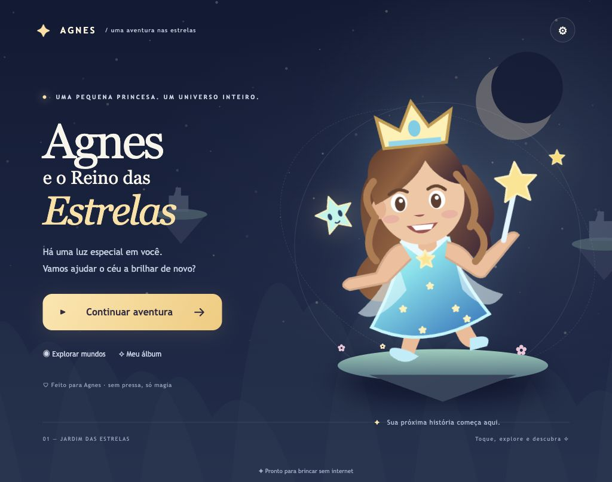

# Agnes e o Reino das Estrelas ✦

Uma aventura 2D de plataformas para Agnes, em português, com React, TypeScript, Vite, Phaser 3 e PWA. Três mundos ampliados e uma arena final com chefão, 90 estrelas e nove amigos estelares originais chamados Lumas. A personagem é uma interpretação ilustrada da referência: cabelo castanho, vestido azul, coroa e varinha. A fotografia não está incluída no projeto.



## Executar

Requer Node.js 20.19+ ou 22.12+ e npm.

```sh
npm ci
npm run dev
```

Abra a URL mostrada no terminal. Para conferir a versão final com PWA:

```sh
npm run build
npm run preview
```

O preview normalmente abre em http://localhost:4173. O servidor aceita conexões da rede local. Não exponha esse servidor diretamente à internet.

## Brincar

- Teclado: ← / → para andar, ↑ ou espaço para pular, X para disparar magia. Segure para atirar continuamente.
- Tablet: setas à esquerda, magia e pulo à direita. Os controles aceitam vários dedos ao mesmo tempo e liberam as ações ao cancelar um toque.
- Segurar o pulo leva mais alto; toques curtos produzem pulos menores. A magia também recolhe itens em um raio próximo.
- Reúna os três Lumas e atravesse o portal para concluir cada mundo.
- Os pontos de luz salvam o ponto de retorno. Cair tira um dos cinco corações e devolve Agnes ao ponto de retorno. Os itens encontrados são preservados.
- Encostar em inimigos ou cristais tira apenas um coração, sem retorno ao checkpoint, com proteção temporária de 1,8 segundo.
- Ao zerar os corações, aparece GAME OVER. Tentar novamente reinicia a fase com cinco corações e mantém os colecionáveis.
- Depois do terceiro mundo, a arena final desbloqueia. Acerte doze tiros no Guardião e desvie dos feitiços; ele fica mais rápido com metade da energia.
- O álbum registra os nove amigos. Os mundos seguintes desbloqueiam ao concluir o anterior.
- Progresso e som ficam no armazenamento local do navegador. Limpar os dados do site apaga esse progresso. Não há conta nem sincronização entre dispositivos.

## Testar no tablet

1. Conecte computador e tablet à mesma rede Wi-Fi.
2. Rode `npm run dev` e abra no tablet o endereço de rede exibido no terminal (por exemplo `http://192.168.x.x:5173`).
3. Use em paisagem. Verifique andar e pular com dois dedos, magia, pausa e retorno após queda.
4. Colete itens, alcance um ponto de luz, feche e abra o jogo para conferir o salvamento.

O endereço HTTP da rede local serve para testar a jogabilidade. Instalação e service worker exigem HTTPS ou localhost. Para instalar no tablet, use o endereço HTTPS do GitHub Pages.

### Instalar e jogar offline

- **Android / Chrome:** abra o jogo publicado e escolha “Instalar app” ou “Adicionar à tela inicial” no menu. O botão de instalação também pode aparecer nas configurações do jogo.
- **iPad / Safari:** Compartilhar → Adicionar à Tela de Início → Adicionar.
- Aguarde a primeira visita carregar todos os arquivos; o aviso “Pronto para brincar sem internet” aparece após a preparação inicial. Reabra o app em modo avião para validar no aparelho.
- O manifest pede paisagem. Alguns sistemas, especialmente iPadOS, podem ignorar esse pedido; gire o tablet manualmente.
- As atualizações mostram um botão no menu. O jogo aguarda esse toque para recarregar a versão nova.

## GitHub Pages

Repositório: https://github.com/tadrianonet/a-games

Endereço esperado: https://tadrianonet.github.io/a-games/

O fluxo `.github/workflows/deploy.yml` instala as dependências com o lockfile, executa a checagem TypeScript e o build, envia `dist` ao Pages e publica. Ele roda em cada push para `main` e também pode ser iniciado manualmente em Actions.

No GitHub: **Settings → Pages → Build and deployment → Source: GitHub Actions**. Em Actions, acompanhe “Publicar no GitHub Pages”. O acesso ao Pages precisa estar disponível para o repositório na sua conta/plano.

A configuração `base: './'`, os caminhos relativos dos assets e o escopo relativo do manifest permitem servir em `/a-games/` sem alterar o código.

```sh
git add .
git commit -m "Atualiza a aventura da Agnes"
git push origin main
```

## Verificações

```sh
npm run build
npx playwright install chromium
npm run test:e2e
```

A suíte E2E cobre menu, coleta, salto, pausa, salvamento, dois toques simultâneos, orientação e recarregamento offline. Execute após o build. Consulte `VALIDACAO.md` para os resultados efetivamente obtidos nesta entrega e as limitações do ambiente.

## Organização

- `src/main.tsx`: menus, HUD, controles, instalação e ciclo de vida.
- `src/game.ts`: plataformas, física, câmera, coleta, magia, checkpoint, portal e efeitos sonoros.
- `src/progress.ts`: salvamento versionado, validação e mundos.
- `public/`: ilustrações SVG originais, ícones PNG e fundos locais.
- `vite.config.ts`: build, manifest e service worker gerado por vite-plugin-pwa.

As plataformas móveis foram removidas. Os mundos agora têm aproximadamente 6.200 a 7.200 unidades de extensão, 30 estrelas por mundo, mais de 30 plataformas fixas e 6, 12 e 13 inimigos, respectivamente. Dois checkpoints dividem cada percurso. Há três Lumas em cada mundo e uma arena final separada, com chão contínuo, plataformas fixas para saltar, chefão, barra de energia e duas etapas de ataque.

A personagem usa 18 quadros de animação. O projeto preserva os colecionáveis das versões anteriores e adiciona cinco corações aos saves antigos. Corredores, vidas e chefão têm verificações em `npm run test:game`, também executadas no GitHub Actions. As opções de teste `test-world`, `test-lives` e `test-passive` só existem no servidor de desenvolvimento e são eliminadas do build publicado.

Não há anúncios, analytics, serviços de backend ou assets remotos em tempo de execução.

## Arte e dependências

A arte do projeto foi desenhada para esta entrega. Não usa sprites, música, personagens ou logos de jogos comerciais. O nome Luma aqui identifica amigos estelares com desenho próprio. Os efeitos sonoros são sintetizados localmente. A imagem enviada como referência visual e a fotografia familiar não são distribuídas.

Dependências mantêm suas próprias licenças (incluindo MIT para React, Vite e Phaser). Consulte os arquivos de licença nos respectivos pacotes. Documentação técnica: [Phaser Arcade Physics](https://docs.phaser.io/phaser/concepts/physics/arcade), [Vite PWA](https://vite-pwa-org.netlify.app/guide/), [GitHub Pages Actions](https://docs.github.com/en/pages/getting-started-with-github-pages/using-custom-workflows-with-github-pages).

### Reconstruir os sprites

`npm run assets:sprites` gera o atlas PNG a partir da personagem SVG original. `npm run test:assets` verifica os 18 quadros, as oito poses de caminhada e as bordas para detectar recortes. O atlas já está no repositório; os jogadores não precisam instalar ferramentas de arte.
